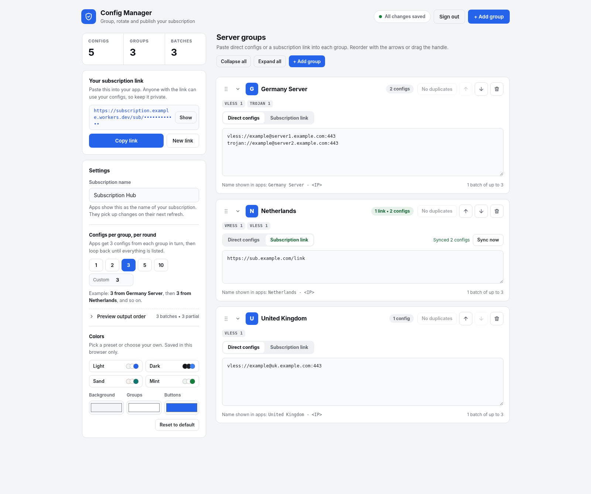

<div dir="rtl">

# 🛡️ Subscription Hub (مدیریت هوشمند کانفیگ و سابسکریپشن)

[**🇬🇧 نسخه انگلیسی (English)**](README.md) | [**🇮🇷 فارسی**](README.fa.md)

یک اسکریپت تک‌فایلی، بدون وابستگی خارجی و فوق‌العاده امن برای **Cloudflare Workers** که به شما امکان می‌دهد کانفیگ‌های V2Ray / Xray / Clash و لینک‌های سابسکریپشن خارجی را در قالب گروه‌های مجزا دسته‌بندی کنید، به‌صورت چرخشی (Round-Robin) مرتب نمایید و از طریق یک داشبورد وب مدرن و کاربرپسند منتشر کنید.



---

## ✨ ویژگی‌های کلیدی

### 🔄 چرخش هوشمند کانفیگ‌ها (Round-Robin) و تغییر نام خودکار
* **چینش چرخشی متوازن بین گروه‌ها:** به‌جای اینکه تمام کانفیگ‌های گروه اول پشت سر هم قرار بگیرند و بعد نوبت به گروه دوم برسد، سیستم در هر دور تعداد مشخصی کانفیگ (`1`، `2`، `3`، `5`، `10` یا هر عدد دلخواه تا `500`) از هر گروه فعال برمی‌دارد و این کار را تا پایان تمام کانفیگ‌ها تکرار می‌کند.
* **پیش‌نمایش زنده ترتیب خروجی:** قبل از ذخیره تغییرات، می‌توانید ترتیب دقیق دسته‌ها (Batches) را در بخش `Preview output order` مشاهده کنید.
* **تغییر نام خودکار کانفیگ‌ها:** نام تمامی کانفیگ‌ها به‌صورت خودکار به فرمت `<نام گروه> - <IP یا دامنه>` تغییر می‌یابد. از تمام پروتکل‌های استاندارد (`vless://`، `vmess://`، `trojan://`، `ss://`، `hysteria2://`، `tuic://` و غیره) و همچنین آدرس‌های IPv4، دامنه و IPv6 (با یا بدون کروشه) پشتیبانی کامل می‌شود.

### 🔗 همگام‌سازی و آپدیت خودکار لینک‌های سابسکریپشن (Auto-Sync)
* **آپدیت خودکار همزمان با رفرش در برنامه کلاینت:** هر بار که کاربر در اپلیکیشن خود (مثل v2rayNG، Hiddify، Streisand، v2rayN یا Clash) لینک سابسکریپشن شما را آپدیت می‌کند، ورکر به‌طور خودکار جدیدترین کانفیگ‌ها را از تمام لینک‌های سابسکریپشن خارجی موجود در گروه‌های فعال دریافت کرده و کش دیتابیس (KV) را بروزرسانی می‌کند.
* **آپدیت زمان‌بندی‌شده در پس‌زمینه (اختیاری - `Off` / `Daily` / `Weekly`):** می‌توانید از داخل پنل مدیریت، آپدیت خودکار روزانه (`Daily`) یا هفتگی (`Weekly`) را فعال یا غیرفعال کنید تا حتی بدون درخواست کلاینت هم کانفیگ‌ها در پس‌زمینه بروز شوند.
* **کش پشتیبان در زمان قطعی سرور مبدا:** اگر هنگام آپدیت کلاینت، یکی از سرورهای سابسکریپشن خارجی موقتاً در دسترس نباشد، سیستم به‌طور خودکار از آخرین کانفیگ‌های سالم ذخیره‌شده در کش (`cachedSubConfigs`) استفاده می‌کند تا ارتباط شما قطع نشود.
* **دکمه «Sync all links» و نمایش زمان آخرین آپدیت:** امکان همگام‌سازی دستی تمام لینک‌های سابسکریپشن با یک کلیک و مشاهده زمان دقیق آخرین بروزرسانی هر گروه (مثلاً `Synced 14 configs • 5m ago`).

### 🧠 طراحی ارگونومیک و تجربه کاربری (UX) پیشرفته
* **دکمه فعال / متوقف کردن گروه (Active / Paused):** بدون نیاز به حذف گروه یا پاک کردن کانفیگ‌ها، می‌توانید با یک کلیک هر گروه را موقتاً متوقف (`Paused`) کنید تا در خروجی نهایی سابسکریپشن قرار نگیرد.
* **جایگذاری هوشمند (Smart Paste):**
  * **دیکد خودکار Base64:** اگر متن کدگذاری‌شده Base64 یک سابسکریپشن را مستقیم در بخش **Direct configs** پیست کنید، سیستم به‌طور خودکار آن را شناسایی و به خطوط کانفیگ مجزا تبدیل می‌کند.
  * **تشخیص هوشمند لینک اشتراک:** اگر به اشتباه لینک `https://` را در بخش کانفیگ مستقیم وارد کنید، با یک کلیک روی پیام بازشده می‌توانید گروه را به حالت **Subscription link** تغییر داده و بلافاصله همگام‌سازی کنید.
* **جستجوی سریع و برچسب پروتکل‌ها:** امکان فیلتر کردن آنی گروه‌ها بر اساس نام، نوع پروتکل (`vless`، `vmess`، `ipv6`) یا وضعیت (`active`، `paused`). همچنین تعداد هر پروتکل، کانفیگ‌های IPv6، خطوط نامعتبر و کانفیگ‌های تکراری (همراه با دکمه حذف تکراری‌ها) به‌صورت زنده نمایش داده می‌شود.
* **ساخت QR کد آفلاین و پیش‌نمایش متنی:** تولید QR کد برداری (SVG) کاملاً داخل مرورگر (بدون ارسال لینک به هیچ سرویس خارجی) برای اسکن سریع با موبایل، به همراه دکمه مشاهده خروجی متنی خام (`?format=plain`).
* **جابجایی آسان (Drag & Drop) و قابلیت بازگردانی (Undo):** تغییر ترتیب گروه‌ها با کشیدن و رها کردن (یا دکمه‌های بالا/پایین)، افزودن گروه جدید دقیقاً بین دو گروه موجود، و امکان بازگردانی (`Undo`) پس از حذف هر گروه.
* **شخصی‌سازی رنگ و پوسته:** هماهنگی خودکار با تم روشن/تاریک سیستم‌عامل، به همراه ۴ پوسته آماده (`Light`، `Dark`، `Sand`، `Mint`) و انتخابگر رنگ دلخواه.

### 🔒 امنیت چندلایه
* **نشست‌های بدون حالت (Stateless) با امضای HMAC-SHA256:** استفاده از کوکی امن `__Host-subhub_session` با پرچم‌های `HttpOnly`، `Secure` و `SameSite=Strict`.
* **محافظت در برابر حملات Brute-Force:** محدود کردن تلاش‌های ناموفق ورود بر اساس IP (حداکثر ۵ تلاش در هر ۱۵ دقیقه).
* **محافظت سخت‌گیرانه CSP و SSRF:** تولید Nonce رمزنگاری‌شده یکتا برای هر درخواست و مسدودسازی دسترسی به آدرس‌های شبکه داخلی و خصوصی.
* **جلوگیری از تداخل ویرایش همزمان:** تشخیص تغییرات ذخیره‌شده در تب یا دستگاه دیگر (`409 Conflict`) و جلوگیری از بازنویسی ناخواسته اطلاعات.

---

## 🚀 راهنمای نصب و راه‌اندازی در کلودفلر

### ۱. ساخت فضای ذخیره‌سازی KV
۱. وارد داشبورد **Cloudflare** شوید و به بخش **Storage & Databases** ← **KV** بروید.
۲. روی **Create a namespace** کلیک کنید و یک نام دلخواه (مثلاً `SUB_HUB_STORE`) برای آن انتخاب نمایید.

### ۲. ساخت و انتشار Worker
۱. به بخش **Workers & Pages** ← **Create** ← **Create Worker** بروید.
۲. یک نام برای ورکر خود انتخاب کرده و روی **Deploy** کلیک کنید.
۳. روی **Edit code** بزنید، کدهای پیش‌فرض را پاک کنید، کد کامل فایل ورکر این مخزن را جایگذاری (Paste) کرده و روی **Deploy** کلیک کنید.

### ۳. اتصال KV و تنظیم رمز عبور داشبورد
۱. در صفحه ورکر خود به تب **Settings** ← **Bindings** ← **Add** ← **KV Namespace** بروید:
   * **Variable name:** عبارت دقیق `STORE` را با حروف بزرگ وارد کنید.
   * **KV namespace:** فضایی که در مرحله ۱ ساختید را انتخاب و ذخیره کنید.
۲. رمز عبور داشبورد (حداقل ۱۰ کاراکتر) را به **یکی از دو روش زیر** تنظیم کنید:
   * **روش پیشنهادی (امن‌تر):** در بخش **Settings** ← **Variables and Secrets**، یک متغیر از نوع **Secret** با نام `ADMIN_PASSWORD` بسازید و رمز عبور خود را در آن قرار دهید.
   * **روش جایگزین (داخل کد):** مقدار متغیر `DASHBOARD_PASSWORD` در ابتدای کد ورکر را ویرایش کرده و Deploy کنید.
۳. *(اختیاری)* در صورت نیاز به تغییر User-Agent هنگام دریافت لینک‌های سابسکریپشن خارجی، می‌توانید یک متغیر متنی با نام `SUB_FETCH_UA` تعریف کنید.

### ۴. (اختیاری) فعال‌سازی Cron Trigger برای آپدیت زمان‌بندی‌شده
لینک‌های سابسکریپشن خارجی به‌صورت پیش‌فرض هر بار که اپلیکیشن کلاینت شما لینک را آپدیت کند، به‌طور خودکار همگام‌سازی می‌شوند. اگر می‌خواهید علاوه بر آن، از گزینه **Daily (روزانه)** یا **Weekly (هفتگی)** در پنل استفاده کنید:
۱. به بخش **Settings** ← **Triggers** ← **Cron Triggers** در تنظیمات ورکر بروید.
۲. یک زمان‌بندی مانند `0 * * * *` (بررسی ساعتی) یا `0 0 * * *` (بررسی روزانه) اضافه کنید.
۳. اکنون می‌توانید هر زمان که بخواهید از داخل داشبورد، بخش **Scheduled background sync** را روی `Off`، `Daily` یا `Weekly` قرار دهید.

---

## 🔗 ساختار لینک سابسکریپشن و پارامترها

لینک اختصاصی شما به‌صورت خودکار با یک توکن تصادفی ۱۲۸ بیتی ساخته می‌شود و در ستون سمت چپ داشبورد قابل کپی یا اسکن است:

</div>

```text
https://<your-worker>.<your-subdomain>.workers.dev/sub/<your-secret-token>
```

<div dir="rtl">

### پارامترهای کاربردی لینک
* **مشاهده خروجی متنی خام در مرورگر (`?format=plain`):** برای بررسی مستقیم کانفیگ‌های تولیدشده بدون کدگذاری Base64:

</div>

```text
https://<your-worker>.workers.dev/sub/<token>?format=plain
```

<div dir="rtl">

* **تغییر تعداد کانفیگ در هر دور چرخش برای یک دستگاه خاص (`?chunk=N`):**

</div>

```text
https://<your-worker>.workers.dev/sub/<token>?chunk=5
```

<div dir="rtl">

---

## ⌨️ کلید میانبر

* **`Ctrl + S` / `Cmd + S`**: ذخیره فوری تمام تغییرات در هر جای صفحه.

---

## 📄 مجوز (License)

منتشر شده تحت مجوز MIT.

</div>
