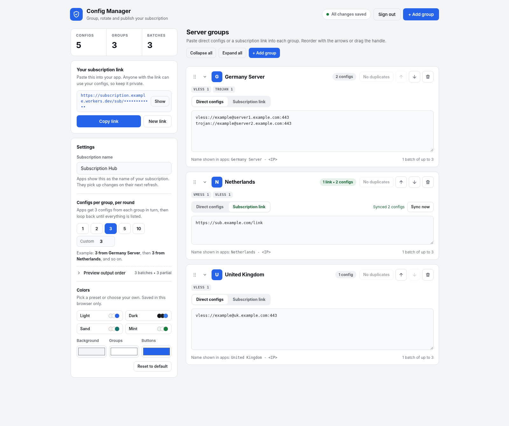

# 🛡️ Subscription Hub (Config Manager)

[**🇬🇧 English**](README.md) | [**🇮🇷 مطالعه نسخه فارسی (Persian)**](README.fa.md)

A single-file, zero-dependency **Cloudflare Worker** that lets you organize, group, rotate, and publish V2Ray / Xray / Clash proxy configurations and remote subscription links through a hardened, ergonomic web dashboard.



---

## ✨ Key Features

### 🔄 Smart Round-Robin Rotation & Renaming
* **Balanced Batch Rotation:** Instead of listing all configs from one server group before moving to the next, Subscription Hub interleaves them in customizable rounds (`1`, `2`, `3`, `5`, `10`, or any custom number from `1–500`).
* **Visual Output Preview:** Inspect the exact batch sequence (including partial final batches) directly in the dashboard before saving.
* **Automatic Config Renaming:** Automatically rewrites remarks/names to `<Group Name> - <IP or Host>` across URL-based schemes (`vless://`, `trojan://`, `ss://`, `tuic://`, `hysteria2://`, etc.) and Base64-JSON schemes (`vmess://`), with full support for IPv4, domains, and bracketed/unbracketed IPv6.

### 🔗 Automatic Subscription Syncing
* **Live Sync on Client App Refresh:** Every time your proxy client app (v2rayNG, Streisand, Hiddify, v2rayN, Clash, etc.) updates your hub link, the Worker automatically fetches fresh configs from all active remote subscription URLs and updates its KV cache.
* **Optional Scheduled Background Sync (`Off` / `Daily` / `Weekly`):** Choose whether to run background syncs on a daily or weekly schedule using Cloudflare Cron Triggers—controllable directly from the dashboard UI.
* **Resilient Fallback Cache:** If a third-party subscription server is temporarily unreachable when your client updates, Subscription Hub seamlessly serves the last known good `cachedSubConfigs` from KV.
* **One-Click "Sync All Links" & Timestamps:** Manually trigger a bulk sync across all subscription groups at once and view relative sync timestamps (`Synced 14 configs • 5m ago`).

### 🧠 Cognitive Ergonomics & Dashboard UX
* **Active / Paused Group Toggle:** Temporarily mute a server group from your published subscription without deleting its configs or losing its position.
* **Smart Paste (Auto-Base64 Decode & Mode Detection):**
  * Paste a raw Base64-encoded subscription block into **Direct configs** and it automatically decodes into individual config lines.
  * Paste `https://` links into **Direct configs** and get a one-click prompt to switch the group to **Subscription link** mode and sync immediately.
* **Instant Search & Protocol Chips:** Filter groups in real time by group name, protocol (`vless`, `vmess`, `ipv6`), or status (`active`, `paused`). Each group displays protocol count badges, IPv6 indicators, unrecognized-line warnings, and a one-click duplicate remover.
* **Built-in Offline QR Code & Plain Preview:** Generate a scannable SVG QR code for mobile apps with zero external requests, or inspect the unencoded output in your browser with one click (`?format=plain`).
* **Drag-and-Drop & Undoable Actions:** Reorder groups via drag handles or arrow buttons, insert new groups between existing ones, and undo accidental group deletions via toast notifications.
* **Custom Themes:** Follows your OS light/dark preference by default, or customize Background, Group, and Button colors (with Light, Dark, Sand, and Mint presets).

### 🔒 Hardened Security
* **Stateless HMAC-SHA256 Sessions:** Uses `__Host-subhub_session` cookies with `HttpOnly`, `Secure`, and `SameSite=Strict`.
* **Brute-Force Protection:** Rate-limits failed login attempts per IP (`5` attempts per `15` minutes) using Cloudflare KV TTL keys.
* **Strict CSP & SSRF Guards:** Per-request cryptographic nonces for scripts/styles (`default-src 'none'`) and outbound fetch validation blocking private/loopback IPv4 and IPv6 ranges.
* **Optimistic Concurrency Control:** Detects if settings were modified in another tab or device (`409 Conflict`) so you never accidentally overwrite newer changes.

---

## 🚀 Quick Setup (Cloudflare Workers)

### 1. Create a KV Namespace
1. Log in to the **Cloudflare Dashboard** and go to **Storage & Databases** → **KV**.
2. Click **Create a namespace** and name it (e.g., `SUB_HUB_STORE`).

### 2. Create & Deploy the Worker
1. Go to **Workers & Pages** → **Create** → **Create Worker**.
2. Name your Worker and click **Deploy**.
3. Click **Edit code**, replace the default script with the contents of `worker.js` from this repository, and click **Deploy**.

### 3. Bind the KV Namespace & Set Your Password
1. Go to your Worker's **Settings** → **Bindings** → **Add** → **KV Namespace**:
   * **Variable name:** `STORE` *(must be exact)*
   * **KV namespace:** Select the namespace you created in Step 1.
2. Set your dashboard password (minimum 10 characters) using **either** method:
   * **Recommended (Secret):** In **Settings** → **Variables and Secrets**, add a **Secret** named `ADMIN_PASSWORD` with your password.
   * **In-Code:** Edit `const DASHBOARD_PASSWORD = "..."` at the top of the script and redeploy.
3. *(Optional)* Add a text variable named `SUB_FETCH_UA` if you want a custom `User-Agent` when fetching remote subscription links (defaults to `SubHub/1.0`).

### 4. (Optional) Enable Scheduled Background Sync
External subscription links already sync automatically whenever your client app refreshes your subscription URL. If you also want to use the **Daily** or **Weekly** background sync option in the dashboard:
1. Go to your Worker's **Settings** → **Triggers** → **Cron Triggers**.
2. Add a Cron schedule such as `0 * * * *` (hourly check) or `0 0 * * *` (daily check).
3. In the Subscription Hub dashboard sidebar under **Scheduled background sync**, select **Daily** or **Weekly** and save. You can switch it back to **Off** in the UI anytime without removing the Cron Trigger.

---

## 🔗 Subscription Endpoint & Query Parameters

Your secret subscription link is generated automatically and shown in the left sidebar of the dashboard:

```text
https://<your-worker>.<your-subdomain>.workers.dev/sub/<your-secret-token>
```

### Supported URL Parameters
* **Inspect Plain Text Output:** Append `?format=plain` to view the decoded, line-by-line output directly in your browser:
  ```text
  https://<your-worker>.workers.dev/sub/<token>?format=plain
  ```
* **Override Rotation Chunk Size per Client:** Append `?chunk=N` (`1–500`) to override the dashboard's default round-robin chunk size for a specific device:
  ```text
  https://<your-worker>.workers.dev/sub/<token>?chunk=5
  ```
* **Alternative Token Formats:** Also supports `/sub-<token>`, `/sub?key=<token>`, or `/?raw=<token>` for compatibility with older clients.

---

## ⌨️ Keyboard Shortcuts

* **`Ctrl + S` / `Cmd + S`**: Save all changes immediately.

---

## 📄 License

MIT License — feel free to fork, customize, and self-host.
